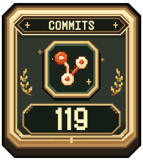
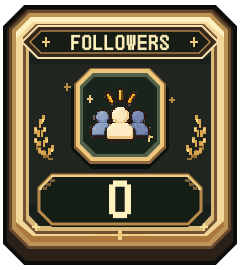

  <h1>Mu-scorpio</h1>
  
Building friendly developer tools with a little pixel magic.

  
  
  
  

  
  
  

## Farmer Passport

  

## Contribution Meadow

  

<em>Generated from my GitHub activity by <a href="https://github.com/Mu-scorpio/farmcraft-profile-generator">FarmCraft 2.0</a> — contributions grow from seeds into grass and flowers.</em>

## FarmCraft 2.0

FarmCraft turns GitHub activity into a pixel village: a two-dimensional contribution meadow, Terraria-inspired loot badges, a GitHub-avatar passport, and embeddable SVG outputs for profile READMEs.

Next.js · React · TypeScript · SVG · next-intl · Cloudflare/Vinext

The SVGs above are generated snapshots stored in this public profile repository so GitHub visitors can render them reliably while the FarmCraft source remains private.
